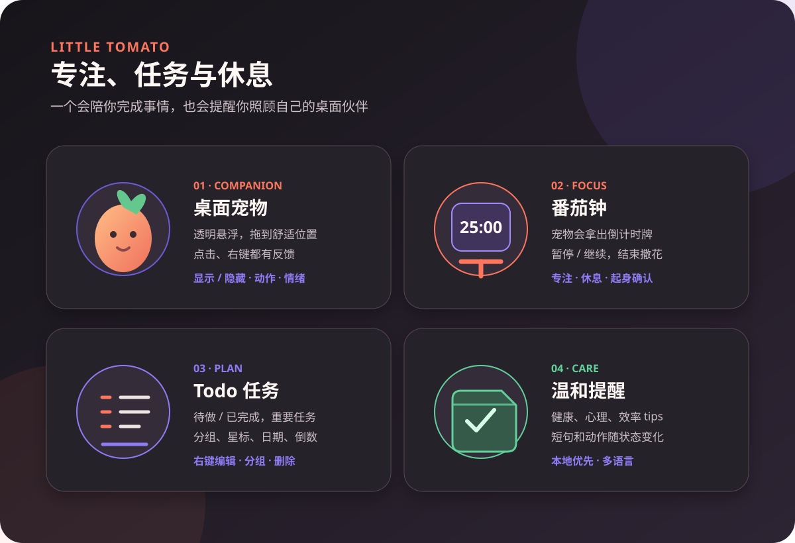
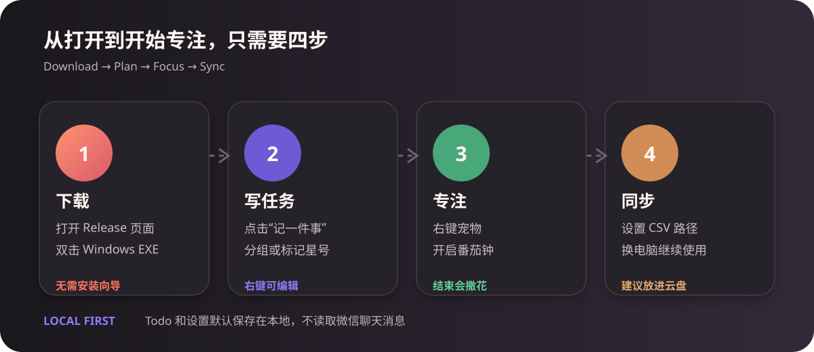

# 小番茄 · Little Tomato

> 让专注有陪伴，让休息有提醒。<br />
> A gentle desktop pet for focus, Todo planning, and healthy breaks.

<p>
  
</p>

[下载 Windows 便携版](https://github.com/xuewei1005/Little-Tomato/releases/tag/v2610-A) · [完整使用说明](./docs/guide.md) · [English guide](./docs/guide.md#english)



## 这是什么？

小番茄是一款可以陪在 Windows 桌面上的专注宠物。它把 Todo、番茄钟、起身提醒和轻量的生活 tips 放在一个安静的小窗口里：你忙的时候，它不会一直打扰；需要休息或任务到点时，它会用动作、表情和简短提示提醒你。



## 功能一览

| 功能 | 能做什么 |
| --- | --- |
| 桌面宠物 | 透明悬浮、拖动位置、点击互动、右键菜单、显示/隐藏宠物 |
| 番茄钟 | 使用默认或自定义时长；宠物会拿出倒计时牌；完成后撒花，并要求确认起身活动 |
| Todo | 待做/已完成切换、标记星号、重要任务、自定义分组、截止日期和倒数 |
| 温和提醒 | Todo 到点提醒、起身提醒、短 tips、休息反馈和宠物情绪变化 |
| 数据同步 | 通过 CSV 文件在不同电脑之间同步 Todo、分组和星标；文件可以放在 OneDrive 等同步目录 |
| 多语言 | 简体中文、English、日本語、한국어、العربية；阿拉伯语支持从右到左布局 |

> 当前版本不读取微信或系统聊天通知。提醒范围是小番茄自己的 Todo、番茄钟、起身提醒和 tips；不会上传个人 Todo 数据。

## 3 分钟开始使用

1. 打开 [Release 页面](https://github.com/xuewei1005/Little-Tomato/releases/tag/v2610-A)，下载 Windows 便携版 EXE。
2. 下载完成后直接双击运行，不需要安装向导；如果 Windows 弹出安全提示，请确认文件来自本项目 Release 页面。
3. 在主界面创建第一件事。点击任务可以选中；右键任务可以设置、移动分组或直接删除。
4. 点击左侧番茄图标显示/隐藏桌面宠物；点击齿轮进入设置。
5. 对宠物右键，可以开启番茄钟、显示/隐藏宠物、打开设置或退出软件。
6. 在设置中选择语言、修改“主人”和“小番茄”的昵称、调整提醒和动画陪伴。

更完整的操作说明、同步方法和常见问题见：[docs/guide.md](./docs/guide.md)。

## Todo 文件同步

1. 在设置中找到“Todo 文件同步”。
2. 填写一个完整的 CSV 文件路径，例如 `D:\OneDrive\小番茄-Todo.csv`。
3. 点击“立即同步”进行一次手动合并；打开“自动同步 Todo”后，后续保存会按该文件同步。
4. 回到另一台电脑，使用同一个 CSV 文件路径，再点击一次“立即同步”。

建议使用 OneDrive、坚果云或其他同步文件夹。不要让两台电脑同时编辑同一个文件，避免同步冲突。CSV 是普通表格文件，可以用 Excel 打开，但不要手动删除 `id` 等字段。

## 本地运行与构建

```powershell
pnpm install
pnpm dev
pnpm test
pnpm build
pnpm tauri build --no-bundle
powershell -NoProfile -ExecutionPolicy Bypass -File .\scripts\build-portable.ps1
```

Windows 发布只保留便携版，不需要安装向导。`outputs` 目录里的 Todo CSV 是本地数据，不应上传到 GitHub。

## 隐私与数据

- Todo、分组、昵称、设置和提醒默认保存在本地。
- 小番茄不读取微信或其他聊天软件的消息内容。
- 项目仓库不会包含个人 Todo CSV、构建产物或密钥文件。

## English

Little Tomato is a calm Windows desktop pet for focus and Todo planning. It combines a transparent companion, a Pomodoro timer, Todo groups, gentle break reminders, and practical tips.

- Download the portable Windows build from the [Release page](https://github.com/xuewei1005/Little-Tomato/releases/tag/v2610-A).
- Double-click the EXE to run it; no installer wizard is required.
- Use the left tomato button to show or hide the pet, and the gear button to open settings.
- Click a task to select it. Right-click a task to edit, move it to a group, or delete it directly.
- Right-click the pet to start a Pomodoro, open settings, show/hide the pet, or quit.
- Todo data can be merged through a CSV file stored in OneDrive or another synced folder.

The current release does not read WeChat or system chat notifications. Personal Todo data stays local and is not included in this repository.

See the [full bilingual guide](./docs/guide.md).
