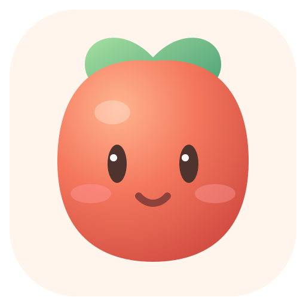
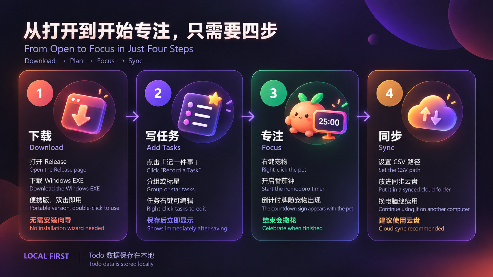
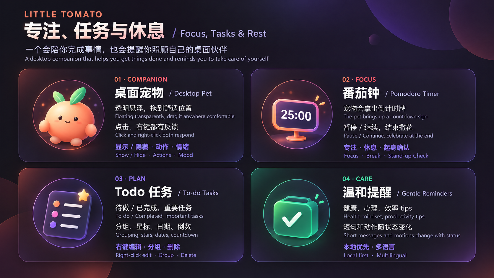

# 小番茄 · Little Tomato

> 让专注有陪伴，让休息有提醒。<br />
> A gentle desktop pet for focus, Todo planning, and healthy breaks.

<p>
  
</p>

[下载 Windows 便携版 / Download portable Windows build](https://github.com/xuewei1005/Little-Tomato/releases/tag/v2610-A) · [完整双语说明 / Full bilingual guide](./docs/guide.md)

[观看介绍视频（2026-10-22） / Watch the introduction video (2026-10-22)](./介绍视频10月22日.mp4)



## 这是什么？ / What is Little Tomato?

小番茄是一款可以陪在 Windows 桌面上的专注宠物。它把 Todo、番茄钟、起身提醒和轻量的生活 tips 放在一个安静的小窗口里：你忙的时候，它不会一直打扰；需要休息或任务到点时，它会用动作、表情和简短提示提醒你。

Little Tomato is a calm Windows desktop pet for focus and Todo planning. It combines a quiet companion, a Pomodoro timer, stand-up reminders, and practical tips. It stays out of the way while you work, then uses small motions, expressions, and short messages when a task or break needs your attention.



## 功能一览 / Features

| 功能 / Feature | 能做什么 / What it does |
| --- | --- |
| 桌面宠物 / Desktop pet | 透明悬浮、拖动位置、点击互动、右键菜单、显示/隐藏宠物<br />A transparent desktop pet with drag, click, context-menu, and show/hide interactions. |
| 番茄钟 / Pomodoro | 默认或自定义时长；倒计时牌；结束撒花并确认起身<br />Use a default or custom duration; the pet shows a countdown board, celebrates, and asks you to confirm a stand-up break. |
| Todo | 待做/已完成切换、标记星号、重要任务、自定义分组、截止日期和倒数<br />Switch between Todo and completed tasks, star important items, use custom groups, deadlines, and countdowns. |
| 温和提醒 / Gentle reminders | Todo 到点、起身、短 tips、休息反馈、宠物情绪变化<br />Todo and break reminders, short tips, rest feedback, and mood changes. |
| 数据同步 / Data sync | 用 CSV 在不同电脑间同步任务、分组和星标；支持 OneDrive 等同步目录<br />Sync tasks, groups, and stars across computers with a CSV file in OneDrive or another synced folder. |
| 多语言 / Languages | 简体中文、English、日本語、한국어、العربية；阿拉伯语支持从右到左布局<br />Simplified Chinese, English, Japanese, and Arabic with right-to-left layout for Arabic. |

> 当前版本不读取微信或系统聊天通知。提醒范围是小番茄自己的 Todo、番茄钟、起身提醒和 tips；不会上传个人 Todo 数据。<br />
> The current release does not read WeChat or system chat notifications. It only handles Little Tomato's own Todo, Pomodoro, break reminders, and tips; personal Todo data is not uploaded.

## 3 分钟开始使用 / Get started in 3 minutes

1. 打开 [Release 页面](https://github.com/xuewei1005/Little-Tomato/releases/tag/v2610-A)，下载 Windows 便携版 EXE。<br />Open the [Release page](https://github.com/xuewei1005/Little-Tomato/releases/tag/v2610-A) and download the portable Windows EXE.
2. 下载完成后直接双击运行，不需要安装向导。<br />Double-click the downloaded EXE to run it; no installer wizard is required.
3. 在主界面创建第一件事。点击任务只负责选中；右键任务可以设置、移动分组或直接删除。<br />Create your first task. Clicking selects a task; right-clicking lets you edit it, move it to a group, or delete it directly.
4. 点击左侧番茄图标显示或隐藏桌面宠物；点击齿轮进入设置。<br />Click the tomato button to show or hide the pet; click the gear button to open Settings.
5. 对宠物右键，可以开启番茄钟、显示/隐藏宠物、打开设置或退出软件。<br />Right-click the pet to start a Pomodoro, show or hide the pet, open Settings, or quit.
6. 在设置中选择语言、修改“主人”和“小番茄”的昵称、调整提醒和动画陪伴。<br />In Settings, choose a language, change the “主人” and “小番茄” nicknames, and adjust reminders and animations.

更完整的操作说明、同步方法和常见问题见：[双语使用说明 / Bilingual user guide](./docs/guide.md)。

## Todo 文件同步 / Todo file sync

1. 在设置中找到“Todo 文件同步”。<br />Open **Todo file sync** in Settings.
2. 填写一个完整的 CSV 文件路径，例如 `D:\OneDrive\小番茄-Todo.csv`。<br />Enter a complete CSV path, for example `D:\OneDrive\Little-Tomato-Todo.csv`.
3. 点击“立即同步”进行一次手动合并；打开“自动同步 Todo”后，后续保存会按该文件同步。<br />Click **Sync now** for a manual merge, then enable automatic sync if you want future saves to use the file.
4. 回到另一台电脑，使用同一个 CSV 文件路径，再点击一次“立即同步”。<br />On another computer, use the same CSV path and click **Sync now** again.

建议使用 OneDrive、坚果云或其他同步文件夹。不要让两台电脑同时编辑同一个文件，避免同步冲突。CSV 是普通表格文件，可以用 Excel 打开，但不要手动删除 `id` 等字段。<br />
OneDrive, Nutstore, or another synced folder is recommended. Do not edit the same file on two computers at the same time. CSV is a normal spreadsheet format and can be opened in Excel, but fields such as `id` should not be removed.

## 本地运行与构建 / Local development and build

```powershell
pnpm install
pnpm dev
pnpm test
pnpm build
pnpm tauri build --no-bundle
powershell -NoProfile -ExecutionPolicy Bypass -File .\scripts\build-portable.ps1
```

Windows 发布只保留便携版，不需要安装向导。`outputs` 目录里的 Todo CSV 是本地数据，不应上传到 GitHub。<br />
Windows releases use only the portable build and do not require an installer wizard. Todo CSV files in `outputs` are local data and should not be uploaded to GitHub.

## 隐私与数据 / Privacy and data

- Todo、分组、昵称、设置和提醒默认保存在本地。<br />Todo items, groups, nicknames, settings, and reminders are stored locally by default.
- 小番茄不读取微信或其他聊天软件的消息内容。<br />Little Tomato does not read WeChat or other chat messages.
- 项目仓库不会包含个人 Todo CSV、构建产物或密钥文件。<br />The repository does not include personal Todo CSV files, build artifacts, or secret keys.
